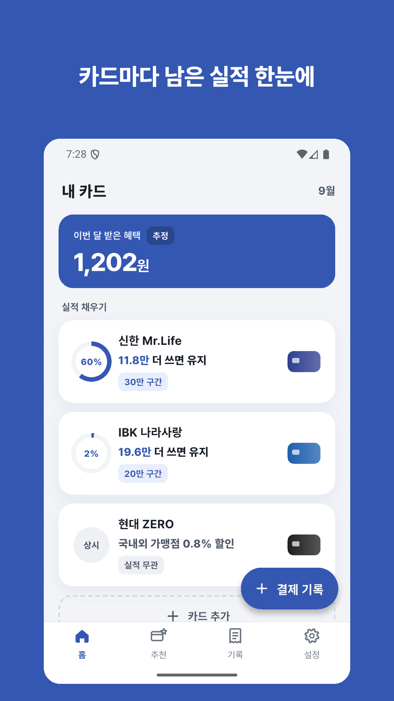
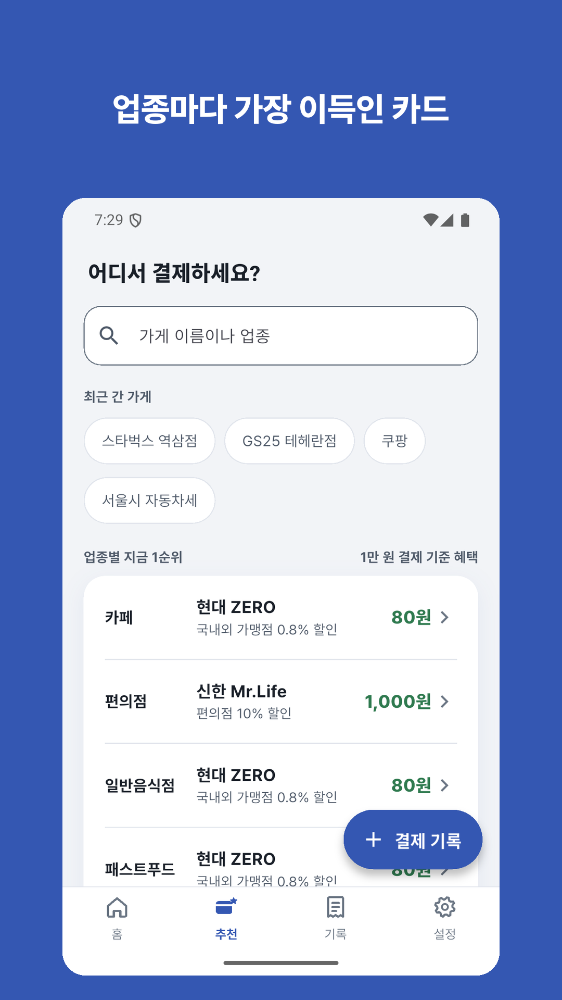
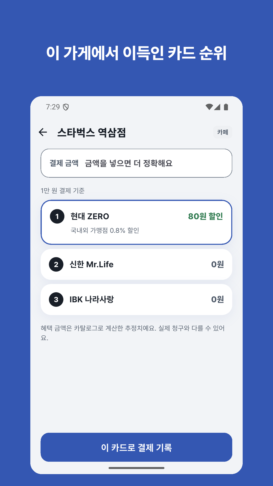
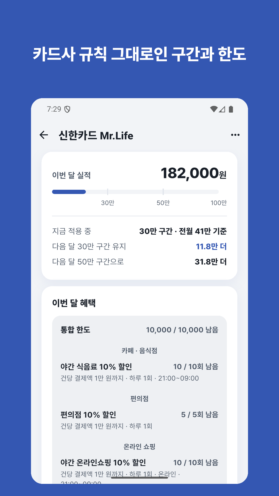
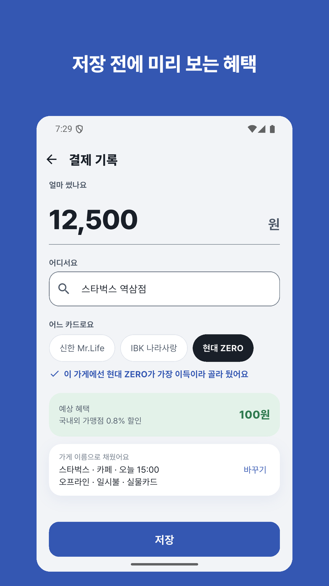
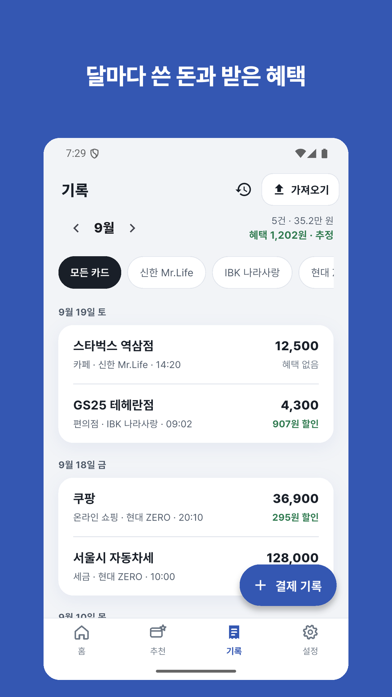
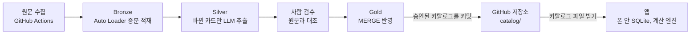
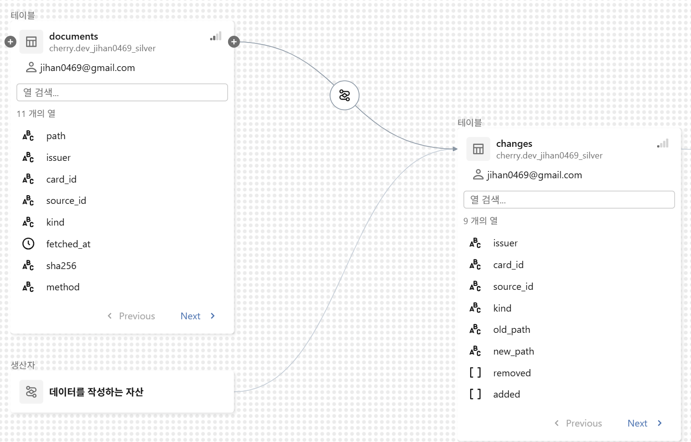

# 🍒 체리컨슘

<br/>

<div align="center">
  
  <h3>체리피커를 위한 카드 실적, 혜택 관리 앱</h3>
  <p>이번 달 실적은 얼마 남았고, 이 가게에선 어느 카드를 낼지 알려 줍니다.</p>

  

<sub>화면 사진의 결제 내역은 지어낸 것입니다</sub>
</div>

## ⌨️ 기간

- **2026.09.19 ~ 진행 중, 1인**

<a name="tableContents"></a>

<br/>

## 🔎 목차

1. <a href="#subject">🎯 주제</a>
1. <a href="#mainContents">⭐️ 주요 기능</a>
1. <a href="#pipeline">⚙ 카드 혜택 데이터 파이프라인</a>
1. <a href="#verify">✅ 계산 검증</a>
1. <a href="#skills">🛠️ 기술 스택</a>
1. <a href="#docs">📑 문서</a>
1. <a href="#progress">📅 진행 순서</a>
1. <a href="#folders">📁 폴더 구조</a>

<br/>

<!------- 주제 -------->

## 🎯 주제

<a name="subject"></a>

카드를 여러 장 쓰다 보면 이번 달 전월실적이 얼마나 찼는지, 지금 이 가게에서는 어느 카드를 내는 게 나은지 헷갈리기 쉽습니다.

**체리컨슘**은 이 두 가지를 알려 주는 앱입니다.

> 로그인 없이 씁니다. 결제 기록과 계산은 폰 안에만 있어 인터넷이 없는 계산대 앞에서도 추천이 뜹니다. 카드번호는 받지 않습니다.

<div align="right"><a href="#tableContents">목차로 이동</a></div>

<br/>

<!------- 주요 기능 -------->

## ⭐️ 주요 기능

<a name="mainContents"></a>

### 실적 현황

<h4>카드마다 이번 달 인정 실적과 다음 구간까지 남은 금액을 보여 줍니다.</h4>

 

---

### 가게별 추천

<h4>가게를 고르면 보유한 카드를 기대 혜택 금액 순으로 정렬합니다.</h4>

- 추천 탭 첫 화면에서 최근 간 가게와 업종별 1순위 카드를 바로 보여 줍니다.
- 조금 더 쓰면 받을 수 있는 혜택도 알려 줍니다.

 

---

### 결제 기록

<h4>금액과 가게, 카드를 직접 입력하거나 카드사 이용 내역 엑셀을 올립니다.</h4>

- 저장하기 전에 예상 혜택과 실적 인정 여부를 보여 줍니다.
- 마이데이터는 쓰지 않습니다. 폰을 바꿀 때는 설정에서 기록을 파일로 내보내 새 폰에서 가져옵니다.

 

<div align="right"><a href="#tableContents">목차로 이동</a></div>

<br/>

<!------- 파이프라인 -------->

## ⚙ 카드 혜택 데이터 파이프라인

<a name="pipeline"></a>

카드사 원문을 모아 LLM으로 혜택을 뽑고, **사람이 승인한 것만** 앱 카탈로그로 냅니다.



- 원문 sha256이 바뀐 카드만 다시 추출합니다.
- MERGE로 반영해 다시 돌려도 중복이 쌓이지 않습니다.
- 규칙이 바뀌면 Delta 변경 데이터 피드와 AUTO CDC로 SCD Type 2 이력을 남깁니다.
- 모델 3종 중 가장 나은 것도 항목 일치율이 44.7%라서 자동 승인을 두지 않았습니다.



<div align="right"><a href="#tableContents">목차로 이동</a></div>

<br/>

<!------- 검증 -------->

## ✅ 계산 검증

<a name="verify"></a>

| 검증 | 결과 |
| --- | --- |
| 계산 코드를 보지 않은 별도 에이전트의 기대값 | 카드 20장, 혜택 190개 대조 |
| 실제 카드 명세서 5달치 | 결제 187건 중 170건 일치, 나머지 17건 원인 분류 |
| 대조할 수 있는 범위의 계산 엔진 오류 | 0건 |

<div align="right"><a href="#tableContents">목차로 이동</a></div>

<br/>

<!------- 기술 스택 -------->

## 🛠️ 기술 스택

<a name="skills"></a>

| 분야 | 기술 | 하는 일 |
|---|---|---|
| 앱 |     | Android 먼저. 폰 안 SQLite에 기록하고 Dart 계산 엔진으로 실적과 추천을 계산합니다 |
| 데이터 파이프라인 |     | 카드사 상품 정보를 모아 LLM으로 혜택을 뽑고, 사람이 검수한 뒤 카탈로그로 냅니다 |
| 자동화 |   | 시험, 파이프라인 배포, 카탈로그 내보내기, 개인정보처리방침 쪽 |
| 서버 | 없음 | 앱이 인터넷으로 하는 일은 공개 저장소의 카탈로그 파일 받기 하나입니다 |

<div align="right"><a href="#tableContents">목차로 이동</a></div>

<br/>

<!------- 문서 -------->

## 📑 문서

<a name="docs"></a>

| 문서 | 내용 |
|---|---|
| [설계 문서](docs/2026-09-19-cherryconsume-design.md) | 확정한 결정과 제약, 전체 구조, 계산 엔진 설계 |
| [ERD](docs/erd.md) | 폰 안 SQLite 표 12개. [렌더 페이지](docs/erd.html) |
| [시나리오와 예외](docs/scenarios.md) | 주요 시나리오 12개, 예외 57개, 운영 예외 4개 |
| [출시 서명과 실제 폰](docs/release-setup.md) | 출시 서명 키 만들기, 실제 폰에 깔기, 기록 지키기 |
| [Databricks를 고른 이유](docs/databricks.md) | 이 프로젝트에서 하는 일, 다른 레이크하우스와 비교, 비용과 제약, 설정 순서 |
| [화면 시안 PDF](design/체리컨슘-화면-시안.pdf) | 고해상도 화면 14개 |

<div align="right"><a href="#tableContents">목차로 이동</a></div>

<br/>

<!------- 진행 -------->

## 📅 진행 순서

<a name="progress"></a>

| 단계 | 내용 | 상태 |
|---|---|---|
| 0 | 기획. 설계, ERD, 와이어프레임, 시나리오 | 완료 |
| 1 | 카탈로그 스키마와 실적, 추천 계산 엔진 | 완료 |
| 2 | 앱 MVP. 서버와 로그인으로 만든 뒤 폰 안 저장과 계산으로 바꿈. 화면 다듬기 | 실제 폰 확인 완료. 실제 카드사 엑셀 확인 남음 |
| 3 | 카드 상품 수집 파이프라인 | 완료 |
| 4 | 카메라 카드 인식 | 뺌 |
| 5 | 출시 준비 | 진행 중 |
| 6 | 결제 알림 읽기. 출시 뒤 Android 부가 기능 | 예정 |

카탈로그 스키마가 추천 계산에 맞는지 카드 20장으로 먼저 확인해 보려고 1단계를 앞에 뒀습니다. 수천 장을 모은 뒤에 스키마를 고치면 되돌리기 어렵습니다.

<div align="right"><a href="#tableContents">목차로 이동</a></div>

<br/>

<!------- 폴더 -------->

## 📁 폴더 구조

<a name="folders"></a>

<details>
<summary>폴더 구조 펼치기</summary>

```
cherryConsume/
├── docs/          기획 문서
│   ├── work/      작업 단위별 의도, 설계, 계획
│   └── history/   요청과 수정 요청, 결과를 작업마다 남긴 기록
├── design/        와이어프레임, 아이콘
├── backend/       카탈로그 읽기와 검사, 파이프라인 Python 코드
├── app/           Flutter 앱. 계산 엔진과 폰 안 저장소
├── catalog/       카드 상품 정의 파일. 원본은 Databricks 골드이고 승인된 개정을 봇이 커밋한다
├── pipeline/      Databricks 번들. 카드 상품 수집 파이프라인과 검수 앱
├── .github/       GitHub Actions. 원문 수집, 파이프라인 배포, 카탈로그 내보내기, 시험
├── .claude/       AI 작업 규칙, 스킬, 자동 검사
└── .githooks/     커밋 메시지와 민감 정보 검사
```

</details>
